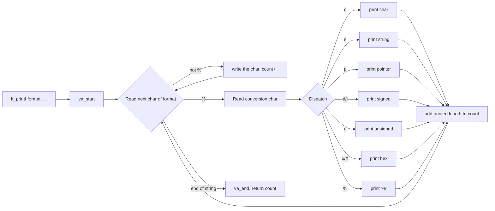
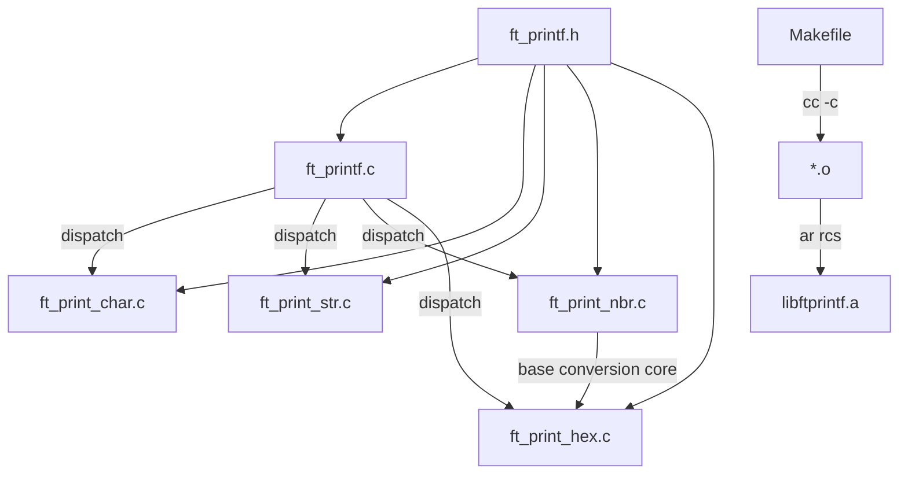

*This project has been created as part of the 42 curriculum by &lt;login1&gt;[, &lt;login2&gt;[, &lt;login3&gt;[...]]].*

# ft_printf — Course & Implementation Guide

> **Subject:** `ft_printf` — *Because ft_putnbr() and ft_putstr() aren't enough* (version 12.1)
> **Output:** `libftprintf.a`, containing `int ft_printf(const char *, ...);`

> ⚠️ **How to use this document.** It is a learning guide written from the official subject. The sections *Description*, *Instructions*, *Resources* (with the AI-usage statement) and *Algorithm & data structure* are the ones the subject requires in the submitted `README.md` (see [§1.4](#14-what-the-subject-requires-in-your-submitted-readme)). Replace the `<login>` placeholder and fill in the parts marked **TODO (yours)**. Trim this guide down before submitting if you want a shorter README. Code snippets here are *illustrative and not Norm-formatted*: write and understand your own implementation.

---

## Table of Contents

1. [Description](#1-description)
2. [Subject analysis (source of truth)](#2-subject-analysis-source-of-truth)
3. [Theoretical foundations](#3-theoretical-foundations)
4. [Step-by-step implementation guide](#4-step-by-step-implementation-guide)
5. [Project structure and file organization](#5-project-structure-and-file-organization)
6. [Functions, algorithms, and data structures](#6-functions-algorithms-and-data-structures)
7. [Instructions: compilation and execution](#7-instructions-compilation-and-execution)
8. [Testing and debugging strategy](#8-testing-and-debugging-strategy)
9. [1337 evaluation and defense preparation](#9-1337-evaluation-and-defense-preparation)
10. [Troubleshooting](#10-troubleshooting)
11. [Resources](#11-resources)
12. [Bonus part guide](#12-bonus-part-guide)
13. [Final verification](#13-final-verification)

---

## 1. Description

### 1.1 What the project is

`ft_printf` asks you to **recode `printf()` from libc** as a static library, `libftprintf.a`. You write a function with a *variable number of arguments* (a **variadic function**), parse a **format string**, and print the matching arguments to standard output with `write()`.

### 1.2 Main objective

Build `int ft_printf(const char *, ...);` so that, for the required conversions `cspdiuxX%`, its output and return value match the original `printf()`. The subject says your function "will be compared against the original `printf()`".

### 1.3 Why it is useful

| Skill | Where it shows up here |
|---|---|
| Variadic functions | `<stdarg.h>`: `va_start`, `va_arg`, `va_copy`, `va_end` |
| String parsing | Walking the format string, spotting `%`, dispatching |
| Number → text conversion | Printing signed/unsigned numbers in bases 10 and 16 without `printf` |
| Pointers & integer representation | `%p`, `%x` of negative numbers, `INT_MIN` |
| Low-level I/O | Unbuffered `write()`, return values, error handling |
| Library building | `ar`, Makefile rules, no needless relinking |
| Extensible design | The subject says: *"The key to a successful ft_printf is well-structured and extensible code."* |

Once the project is passed, you may add `ft_printf()` to your `libft` for later 42 projects.

### 1.4 What the subject requires in your submitted README

From Chapter V of the subject, your **submitted** `README.md` must be at the root of the repo and include at least:

- [ ] **First line italicized:** *This project has been created as part of the 42 curriculum by `<login1>[, <login2>[, <login3>[...]]]`.* (done at the top of this file, replace the placeholder)
- [ ] A **"Description"** section (goal + brief overview) → [§1](#1-description)
- [ ] An **"Instructions"** section (compilation, installation, execution) → [§7](#7-instructions-compilation-and-execution)
- [ ] A **"Resources"** section: classic references **and a description of how AI was used** (for which tasks and which parts of the project) → [§11](#11-resources)
- [ ] **A detailed explanation and justification of the chosen algorithm and data structure** → [§6.0](#60-your-chosen-algorithm-and-data-structure-required-by-the-subject)
- English is recommended (or your campus's main language).

### 1.5 General workflow



---

## 2. Subject analysis (source of truth)

### 2.1 Mandatory requirements (extracted from the subject)

| # | Requirement | Source |
|---|---|---|
| M1 | Written in **C**, following **the Norm** (bonus files included in the norm check; a norm error means **0**) | Ch. II |
| M2 | No unexpected crashes (segfault, bus error, double free…) except undefined behavior, otherwise the project gets **0** | Ch. II |
| M3 | All heap memory freed; **no memory leaks tolerated** | Ch. II |
| M4 | Makefile compiles with **`cc -Wall -Wextra -Werror`**, **must not relink unnecessarily** | Ch. II |
| M5 | Makefile has at least the rules **`$(NAME)`, `all`, `clean`, `fclean`, `re`** | Ch. II, IV |
| M6 | Program (library) name: **`libftprintf.a`**, created **at the root** of the repository | Ch. IV |
| M7 | Library must be built with **`ar`**; **`libtool` is forbidden** | Ch. IV |
| M8 | Header named **`ft_printf.h`**, containing the prototype of `ft_printf()` | Ch. IV |
| M9 | Prototype: `int ft_printf(const char *, ...);` | Ch. IV |
| M10 | **Do not implement the buffer management** of the original `printf()` | Ch. IV |
| M11 | Conversions: **`c s p d i u x X %`** | Ch. IV |
| M12 | Output compared against the original `printf()` | Ch. IV |
| M13 | Turn in: `Makefile, *.h, */*.h, *.c, */*.c` | Ch. IV |
| M14 | README.md at the repo root with required sections | Ch. V |
| M15 | Only the contents of the Git repository are graded | Ch. II, VII |

### 2.2 Allowed / forbidden functions

| Status | Functions |
|---|---|
| ✅ Allowed external functions | `malloc`, `free`, `write`, `va_start`, `va_arg`, `va_copy`, `va_end` |
| ✅ Allowed library | **Your `libft`** ("Libft authorized: Yes"). If used, copy its sources + Makefile into a `libft/` folder; your Makefile must build it via *its* Makefile, then build the project |
| ❌ Forbidden | `libtool` (explicitly). By the subject's list of external functions, anything else not listed (e.g. `printf`, `sprintf`, `putchar`, `strlen` from libc) is **not authorized**: use `write` or your libft equivalents |

> The subject's table lists `malloc` and `free` as allowed but does **not** require them. A clean `ft_printf` can be written with no heap allocation.

### 2.3 Required conversions

| Conversion | Meaning (as in the subject) |
|---|---|
| `%c` | Prints a single character |
| `%s` | Prints a string (as defined by the common C convention) |
| `%p` | The `void *` pointer argument is printed in hexadecimal format |
| `%d` | Prints a decimal (base 10) number |
| `%i` | Prints an integer in base 10 |
| `%u` | Prints an unsigned decimal (base 10) number |
| `%x` | Prints a number in hexadecimal (base 16), **lowercase** |
| `%X` | Prints a number in hexadecimal (base 16), **uppercase** |
| `%%` | Prints a percent sign |

### 2.4 Optional (bonus)

- Any combination of the flags `-`, `0`, `.` and the **field minimum width**, under all conversions.
- All the flags `#`, ` ` (space), `+`.
- Bonus code goes in `_bonus.{c,h}` files, with a **`bonus` rule** in the Makefile.
- ⚠️ **The bonus is assessed only if the mandatory part is PERFECT.**

### 2.5 Ambiguities and missing information (not invented, flagged)

| Topic | What the subject says | What you should do |
|---|---|---|
| `%s` with `NULL` | Only "as defined by the common C convention". `NULL` is not addressed | Real `printf` (glibc) prints `(null)`. Since you're compared against `printf`, matching it is the safest choice. **Ask your evaluator / check the evaluation guidelines.** |
| `%p` with `NULL` | Not addressed | glibc prints `(nil)`; macOS libc prints `0x0`. The result is **platform-dependent**. Test on the machine you'll be evaluated on and document your choice |
| Lone `%` at end of string, or unknown conversion (`%y`) | Not addressed (only `cspdiuxX%` are required) | This is undefined behavior in the C standard. Just make sure you **don't crash**, and document what you do |
| Return value | Not explicitly stated; implied by "compared against the original `printf()`" | Return the number of characters written, like `printf`. On write error, a negative value is the recommended behavior |
| Differences between `%d` and `%i` for output | The subject describes them in different words | For **output**, they behave identically in `printf` (they differ only in `scanf`) |
| "Modification of the project" at evaluation | May be requested; details are in the evaluation guidelines | Prepare, see [§9.5](#95-prepare-for-a-live-modification) |
| Norm version | Not detailed in this subject | Check the current Norm PDF and `norminette` on your campus |

---

## 3. Theoretical foundations

### 3.1 How a C function can take "any number" of arguments

#### What it is
A **variadic function** accepts a fixed set of named parameters followed by `...`:

```c
int ft_printf(const char *format, ...);
```

#### Why it exists
Some functions can't know at compile time how many arguments callers will give them (`printf`, `execl`…).

#### How it works internally
On most platforms, the caller places arguments in **registers and/or on the stack** following the platform's calling convention (the ABI). The callee has *no* type or count information about the `...` part. It can only read them if **you** tell it, in order, what type each next argument has. In `printf`, **the format string is that information**.

`<stdarg.h>` provides portable macros hiding the ABI details:

| Macro | Role |
|---|---|
| `va_list ap;` | A variable that tracks "where we are" in the argument list |
| `va_start(ap, last_named)` | Initializes `ap` to point just after the last named parameter (`format`) |
| `va_arg(ap, type)` | Returns the next argument interpreted **as `type`** and advances `ap` |
| `va_copy(dst, src)` | Duplicates the state of a `va_list` (needed to traverse it twice or hand a copy to a helper) |
| `va_end(ap)` | Cleans up. **Must** be called before returning, on every path, for every `va_start`/`va_copy` |

#### Mini example (not part of the solution)

```c
#include <stdarg.h>

int sum_ints(int count, ...)
{
    va_list ap;
    int     total;

    total = 0;
    va_start(ap, count);
    while (count-- > 0)
        total += va_arg(ap, int);
    va_end(ap);
    return (total);
}
```

#### Relation to the project
`ft_printf` reads `format` char by char. When it sees `%d` it calls `va_arg(ap, int)`; for `%s`, `va_arg(ap, char *)`, etc.

#### Common mistakes and misconceptions
- **Wrong type in `va_arg`** → undefined behavior (garbage output, or crash). The type must match what the caller passed *after default promotions*.
- **Reading more arguments than were passed** → undefined behavior. (`printf("%d")` with no argument is the *caller's* bug, but your code must not crash on legitimate input.)
- **Forgetting `va_end`.**
- **Passing `va_list` by value** to a helper and then reusing it in the caller: the state after the call is *indeterminate* per the C standard. The safe way is to pass a **pointer to the `va_list`** (`va_list *`), or use `va_copy`. A very common design is to pass `va_list *` to the dispatcher so every handler consumes from the same cursor.
- Believing `char` is passed as `char` (see next section).

#### Edge cases
- `ft_printf("")`: no `va_arg` calls at all; return `0`.
- `ft_printf("%%")`: `%%` consumes **no** argument.

#### Questions you should be able to answer
1. What are the 4 `stdarg` macros used here and what does each do?
2. Why does `va_arg` need the type? How does the function know how many arguments exist?
3. Why can't you loop over `...` like an array?
4. What happens if the format says `%s` but the caller passed an `int`?
5. Why use `va_list *` rather than `va_list` when passing it to helpers?

### 3.2 Default argument promotions (why `%c` reads an `int`)

#### What / why
For the `...` part, the C language applies **default argument promotions**: `char` and `short` become `int`; `float` becomes `double`. So a `char` argument arrives as an `int`.

#### Relation to the project
- `%c` → `va_arg(ap, int)`, then convert to `unsigned char` before writing.
- `%d` / `%i` → `va_arg(ap, int)`.
- `%u`, `%x`, `%X` → `va_arg(ap, unsigned int)`.
- `%s` → `va_arg(ap, char *)`.
- `%p` → `va_arg(ap, void *)`, then convert to an unsigned integer type wide enough to hold a pointer (`unsigned long` / `uintptr_t`/ `unsigned long long`).

#### Common mistakes
- Using `va_arg(ap, char)` → undefined behavior (compilers usually warn).
- Reading `%x` as `int` and shifting: use `unsigned int`.

### 3.3 Variable-length formatting: the format-string grammar (for this subject)

Mandatory subset:

```
format  :=  ( literal-char | '%' conversion )*
conversion := 'c' | 's' | 'p' | 'd' | 'i' | 'u' | 'x' | 'X' | '%'
```

Full `printf` (relevant to the bonus):

```
%[flags][width][.precision][length]conversion
```

The mandatory part only needs the first form. The bonus adds `flags` (`- 0 # space +`), `width`, `.precision`. Design the parser now so these can be inserted later without rewriting everything (the subject's explicit hint).

### 3.4 Integers, signedness, and two's complement

#### What it is
Computers store integers in **binary**. On virtually all platforms, signed `int` uses **two's complement**. `INT_MIN` is `-2147483648`, and `-INT_MIN` **does not fit in an `int`** (signed overflow → undefined behavior).

#### Why it matters here
- `%d` of `INT_MIN`: negating inside an `int` is UB. Convert to a wider type (`long`, `long long`) **before** negating, or work with the absolute value as an `unsigned`.
- `%x` of a negative `int`: `printf` reinterprets the bits as `unsigned int`. `-1` prints `ffffffff`. If you read the argument with `va_arg(ap, unsigned int)` this happens automatically.
- `%u` of `-1` prints `4294967295` (for 32-bit `unsigned int`).

#### Example

| Call | Output |
|---|---|
| `printf("%d", INT_MIN)` | `-2147483648` |
| `printf("%u", -1)` | `4294967295` |
| `printf("%x", -1)` | `ffffffff` |
| `printf("%X", 255)` | `FF` |
| `printf("%x", 0)` | `0` (not an empty string!) |

#### Common mistakes
- Printing nothing for `0` because your recursion stops at `n == 0`.
- Overflowing on `INT_MIN`.
- Treating `%i` differently from `%d`.

### 3.5 Converting a number to text in a given base

#### What problem it solves
`write()` only writes **bytes**. To print the number `42` you must write the characters `'4'` and `'2'`.

#### How it works
Repeated division: `digit = n % base`, `n = n / base`. The digits come out **least-significant first**, but you need to print them **most-significant first**. Two classic ways:

| Approach | Idea | Trade-offs |
|---|---|---|
| **Recursion** | Recurse on `n / base` first, then print `n % base` | Short; depth ≤ ~20 for base 10, ≤ 16 for hex in 64-bit; no buffer |
| **Local buffer filled from the end** | `char buf[N]`; fill from index N-1 downward; then write once | One `write` per number, handy for width/precision in the bonus; no malloc needed |
| `malloc`'d string (`itoa`-style) | Build a string then print + free | Needs `free` on every path (leak risk); only worth it if reusing your libft `ft_itoa` |

Digit lookup trick: `"0123456789abcdef"[n % 16]` (use `"0123456789ABCDEF"` for `%X`). This explains *why* a single function can serve `%d`, `%u`, `%x`, `%X` with just a different `base` string.

#### Example (base 16 of 255)

```
255 / 16 = 15 remainder 15 → 'f'
 15 / 16 =  0 remainder 15 → 'f'
→ digits (reverse order) "ff"
```

#### Complexity
Time `O(log_base n)`; space `O(1)` (buffer) or `O(log n)` stack (recursion).

#### Questions to answer
- Why does a naive recursion print nothing for `0`?
- Why is it safe to use `unsigned long long` as the universal type for the helper?
- How many digits does `UINT_MAX` have in base 10? In base 16? (10 and 8)

### 3.6 Pointers and `%p`

#### What it is
A pointer is an address (an integer, usually 64 bits on modern systems). `%p` prints it in hexadecimal.

#### What `printf` actually prints (glibc, Linux)
`0x` followed by lowercase hex digits without leading zeros: `0x7ffd1c2a3b4c`. For a **NULL** pointer, glibc prints `(nil)`; other libcs (e.g. macOS) print `0x0`. **The subject only says the pointer "has to be printed in hexadecimal format"**, so the NULL behavior is yours to decide and defend (see [§2.5](#25-ambiguities-and-missing-information-not-invented-flagged)).

#### How to implement
1. `va_arg(ap, void *)`.
2. Convert to `unsigned long` (or `uintptr_t` if allowed by your headers; check subject/Norm; `unsigned long long` is also common).
3. Print `"0x"`, then the number in base 16 lowercase.

#### Common mistakes
- Casting to `int`: truncates 64-bit addresses on most systems.
- Printing `%p` in uppercase.
- Forgetting to count the 2 characters of the `0x` prefix in the return value.

### 3.7 `write()`, return values, and unbuffered output

#### What it is
`ssize_t write(int fd, const void *buf, size_t count);` writes up to `count` bytes to file descriptor `fd` (1 = stdout). It returns the number of bytes written, or `-1` on error.

#### Why "do not implement the buffer management"
The real `printf` accumulates output in a buffer (stdio) and flushes later (when full, at newline on a terminal, at exit…). The subject says you **do not** need to replicate that: you may call `write` directly each time. It's slower (more syscalls) but simple and correct.

#### ⚠️ Important gotcha when testing against the real `printf`
Since libc `printf` is **buffered** and your `ft_printf` is **not**, mixing both in one program can print in a *different order* when stdout is a pipe or a file (not a terminal). Fix in tests: call `fflush(stdout)` after each `printf`, or compare each function in a separate run/process. (In your *library* you must not use `fflush`: that's `stdio`, not in your allowed list; this is for the **test program only**.)

#### The return value
`printf` returns **the total number of characters written**. Your function must do the same, so every helper should return how many bytes it wrote.

| Call | Output | Return |
|---|---|---|
| `printf("abc")` | `abc` | `3` |
| `printf("%c", 'a')` | `a` | `1` |
| `printf("%%")` | `%` | `1` |
| `printf("%s", "")` | *(nothing)* | `0` |
| `printf("%c", 0)` | a NUL byte | `1` |
| `printf("%d", -42)` | `-42` | `3` |

Note `%c` with `0`: one byte `\0` is written and counted. This is why you must use `write` with a length rather than a C string function.

### 3.8 Strings and `%s`

- A C string is a `char` array ending in `'\0'`. Length is computed by scanning (use your `ft_strlen`; libc `strlen` is not in the allowed list).
- `%s` writes the characters up to (excluding) the NUL; return value = length.
- `NULL`: see ambiguity table. Dereferencing `NULL` is a segfault, which gives you a **0** under the subject's crash rule, so **handle it explicitly**.
- Empty string `""`: prints nothing, returns 0.

### 3.9 Static libraries, `ar`, linking

#### What it is
A **static library** (`.a`) is an *archive* of object files (`.o`). When another project links with it (`cc main.c libftprintf.a`), the linker copies only the needed objects into the executable.

#### How it's built
```
cc -Wall -Wextra -Werror -c file.c -o file.o     # compile to object
ar rcs libftprintf.a file1.o file2.o ...          # archive them
```
`ar` flags: `r` insert/replace members, `c` create the archive silently, `s` write an index (equivalent to running `ranlib`). The subject **requires `ar`** and forbids `libtool`.

#### Why the Makefile must not relink
`make` decides what to rebuild by comparing **timestamps** of targets and prerequisites. If `$(NAME)` depends on `$(OBJS)` and `.o` depends on `.c` (and header), a second `make` with no changes prints *"Nothing to be done"* (or equivalent) and does nothing. Common ways to break this: a phony `$(NAME)` target, rules without real file targets, always-run commands.

### 3.10 Makefile essentials for this subject

| Rule | Meaning |
|---|---|
| `$(NAME)` | Builds `libftprintf.a` from objects |
| `all` | Default target; depends on `$(NAME)` |
| `clean` | Removes object files |
| `fclean` | `clean` + removes `$(NAME)` |
| `re` | `fclean` then `all` |
| `bonus` | Only if you do the bonus (required by Ch. II if you submit bonuses) |
| `.PHONY` | Marks rules that are not real files (`all clean fclean re bonus`) |

Recommended concepts: automatic variables (`$@`, `$<`), pattern rules (`%.o: %.c`), header dependency so changing `ft_printf.h` triggers recompilation.

---

## 4. Step-by-step implementation guide

Each phase has a checkpoint. Don't move on until it passes.

### Phase 0: Setup

- **Objective:** Repo, Makefile skeleton, header, empty `ft_printf` that compiles into `libftprintf.a`.
- **Theory:** [§3.9](#39-static-libraries-ar-linking), [§3.10](#310-makefile-essentials-for-this-subject).
- **Implementation:**
  1. Create the files described in [§5](#5-project-structure-and-file-organization).
  2. Write `ft_printf.h` with include guards and the prototype `int ft_printf(const char *, ...);`.
  3. Write a stub `ft_printf` returning 0.
  4. Write the Makefile: `NAME = libftprintf.a`, `CC = cc`, `CFLAGS = -Wall -Wextra -Werror`, rules per [§3.10](#310-makefile-essentials-for-this-subject).
- **Expected result:** `make` creates `libftprintf.a` at the repo root; second `make` does nothing.
- **Testing:** `make && make` (second run must say nothing to do); `ar t libftprintf.a` lists your objects; `norminette`.
- **Common errors:** `.a` created in a subfolder; missing `-Werror` consistency; `re` not rebuilding.
- **Checkpoint:**
  - [ ] `libftprintf.a` at root
  - [ ] No relink on second `make`
  - [ ] `make clean`, `make fclean`, `make re` behave
  - [ ] Norm OK

### Phase 1: Plain text and the return value

- **Objective:** `ft_printf("hello\n")` prints and returns 6.
- **Theory:** [§3.7](#37-write-return-values-and-unbuffered-output).
- **Implementation (pseudocode):**
  ```
  count = 0
  va_start(ap, format)
  i = 0
  while format[i]:
      write format[i]; count += 1
      i += 1
  va_end(ap)
  return count
  ```
- **Expected result:** Behaves like `printf` for strings without `%`.
- **Testing:** Compare output and return value with `printf` for `""`, `"a"`, `"hello\n"`, a long string.
- **Common errors:** Forgetting `va_end`; using `printf` in the library (forbidden!).
- **Checkpoint:**
  - [ ] Output and return value match for strings without `%`

### Phase 2: Dispatch skeleton with `%%`

- **Objective:** Detect `%`, read the next char, route to a handler.
- **Theory:** [§3.3](#33-variable-length-formatting-the-format-string-grammar-for-this-subject).
- **Implementation:** Create a function like `handle_conversion(char c, va_list *ap)` that returns the number of characters printed (or a negative number on error). Start with only `'%'` → writes `%`, returns 1.
- **Why `va_list *`:** every handler advances the *same* cursor ([§3.1](#31-how-a-c-function-can-take-any-number-of-arguments)).
- **Expected result:** `ft_printf("100%%\n")` prints `100%` and newline; returns 5.
- **Testing:** `"%%"`, `"%%%%"`, `"a%%b"`.
- **Common errors:** Advancing the format index wrong (skipping or re-reading the conversion char); consuming a `va_arg` for `%%`.
- **Checkpoint:**
  - [ ] `%%` works in every position
  - [ ] The dispatcher cleanly returns to the main loop

### Phase 3: `%c` and `%s`

- **Objective:** Characters and strings.
- **Theory:** [§3.2](#32-default-argument-promotions-why-c-reads-an-int), [§3.8](#38-strings-and-s).
- **Implementation:** `%c`: `va_arg(ap, int)` → cast to `unsigned char` → write 1 byte. `%s`: `va_arg(ap, char *)`; if `NULL`, decide and print the replacement (e.g. `(null)`, as glibc does); else write `ft_strlen` bytes.
- **Expected result:** `"%c"` with `'x'`, `0`, `'\n'`; `"%s"` with `"abc"`, `""`, `NULL`.
- **Testing:** Compare with `printf` including `%c` with `0` (return must be 1).
- **Common errors:** `va_arg(ap, char)`; segfault on `NULL`; treating NUL char as end of output.
- **Checkpoint:**
  - [ ] `%c` returns 1 always (even for `0`)
  - [ ] `%s` handles empty string and `NULL` without crashing

### Phase 4: Number printing core (base conversion)

- **Objective:** One generic function that prints an `unsigned long long` in a given base and returns the digit count.
- **Theory:** [§3.4](#34-integers-signedness-and-twos-complement), [§3.5](#35-converting-a-number-to-text-in-a-given-base).
- **Implementation (pseudocode):**
  ```
  put_unsigned_base(n, digits_string):
      base = length(digits_string)
      if n >= base:
          r = put_unsigned_base(n / base, digits_string)
          if r < 0: return r
      write digits_string[n % base]
      return (number_of_digits)   # accumulate properly!
  ```
  Be careful to **count** correctly across the recursion levels, and to **propagate write errors**.
- **Expected result:** Prints `0`, `7`, `10`, `4294967295`, `ff`, `FF`.
- **Testing:** Boundaries: `0`, `1`, `9`, `10`, `15`, `16`, `UINT_MAX`, `ULONG_MAX` (for the pointer path).
- **Common errors:** Nothing printed for `0`; off-by-one in the count; using signed types.
- **Checkpoint:**
  - [ ] Works for base 10, 16 lower, 16 upper
  - [ ] Returns the right digit count

### Phase 5: `%u`, `%x`, `%X`

- **Objective:** Unsigned conversions.
- **Implementation:** `va_arg(ap, unsigned int)`, then call the core with the right digit string.
- **Testing:** `0`, `1`, `255`, `-1` (as an argument; `%u`→`4294967295`, `%x`→`ffffffff`), `UINT_MAX`.
- **Common errors:** Using `int`; wrong case.
- **Checkpoint:**
  - [ ] Matches `printf` for all values above

### Phase 6: `%d` and `%i`

- **Objective:** Signed decimal, including `INT_MIN`.
- **Implementation:** read `int`; widen to `long long` (or handle sign separately); if negative write `-` (count 1) then print the magnitude via the core. Both `d` and `i` route to the same handler.
- **Testing:** `0`, `1`, `-1`, `42`, `-42`, `INT_MAX`, `INT_MIN`.
- **Common errors:** `-INT_MIN` overflow; forgetting to add 1 to the count for `-`; `-0`.
- **Checkpoint:**
  - [ ] `INT_MIN` and `INT_MAX` correct
  - [ ] Return value counts the sign

### Phase 7: `%p`

- **Objective:** Pointers.
- **Theory:** [§3.6](#36-pointers-and-p).
- **Implementation:** read `void *`, convert to unsigned wide integer; handle `NULL` per your documented decision; else write `"0x"` + base-16 lowercase; return `2 + digits`.
- **Testing:** Address of a local variable, of a string literal, of a `malloc`'d block, `NULL`. Compare with `printf` (addresses vary per run; compare the *format* and return length, or print the same pointer from both functions in the same process).
- **Common errors:** Truncating to `int`; uppercase; forgetting `0x` in the count.
- **Checkpoint:**
  - [ ] Output identical to `printf` for the same pointer on your platform
  - [ ] `NULL` behavior documented

### Phase 8: Robustness and error handling

- **Objective:** No crash, consistent return value, no leaks.
- **Implementation:**
  - Propagate negative returns from `write` all the way up; return `-1` if any write fails (recommendation).
  - Decide behavior for a lone `%` at the end and for unknown conversions; make sure you never read past the end of the format string (`format[i + 1]` when `format[i]` is the NUL).
  - Handle `format == NULL` defensively (recommended; real `printf` with `NULL` is UB).
  - Ensure `va_end` is called on **every** exit path.
- **Testing:** `ft_printf("%")`, `ft_printf("abc%")`, `ft_printf("%y")`; closed stdout (`./a.out >&-`) to simulate write failure.
- **Checkpoint:**
  - [ ] No segfault on the odd inputs above
  - [ ] Valgrind / sanitizer clean

### Phase 9: Mandatory polish

- **Objective:** Norm, Makefile, extensibility.
- Review: Norm compliance, minimal duplication, one responsibility per function, README written, `.gitignore` for `.o` files and `libftprintf.a` (recommendation: don't commit build artifacts, but follow your campus's repo rules).
- **Checkpoint:**
  - [ ] [§13 final verification](#13-final-verification) all green

### Phase 10 (optional): Bonus

See [§12](#12-bonus-part-guide). Only after the mandatory part is perfect.

---

## 5. Project structure and file organization

The subject requires: **`Makefile`, `*.h`, `*.c`** (subfolders allowed: `*/*.h`, `*/*.c`), a header named **`ft_printf.h`**, and `libftprintf.a` **at the root**. The layout below is a *recommendation*:

```
.
├── Makefile                  # mandatory
├── README.md                 # mandatory (Ch. V)
├── ft_printf.h               # mandatory, contains ft_printf prototype
├── ft_printf.c               # main function: va_start, loop, dispatch, va_end
├── ft_print_char.c           # %c and %%  (optional split)
├── ft_print_str.c            # %s
├── ft_print_nbr.c            # %d %i %u
├── ft_print_hex.c            # %x %X and %p
├── libft/                    # OPTIONAL: copy of your libft (sources + its Makefile)
└── (bonus only)
    ├── ft_printf_bonus.h
    └── *_bonus.c
```

| File | Purpose | Mandatory? |
|---|---|---|
| `Makefile` | Builds `libftprintf.a` with `cc -Wall -Wextra -Werror` and `ar` | Yes |
| `ft_printf.h` | Prototype of `ft_printf` + prototypes of your helpers, include guards, `#include <stdarg.h>`, `<unistd.h>` | Yes (name fixed) |
| `ft_printf.c` | Entry point and format-string walker | Yes (the file name is free; the function name is fixed) |
| Handler files | One function per conversion family | Organization choice |
| `libft/` | Only if you reuse it; must be built by *its own* Makefile from yours | Optional |
| `*_bonus.{c,h}` | Bonus code only | Only for bonus |
| Tests (`main.c`, scripts) | Not graded, not required in the repo | Optional (keep them outside or git-ignored) |

**How files interact:**



> ⚠️ Norm reminders (verify against the Norm document and `norminette` on your campus; I am not quoting an exact version): function length, number of functions per file, number of parameters, and variable declarations are all limited. This is the main reason to split into many small functions: it also makes the design extensible.

---

## 6. Functions, algorithms, and data structures

### 6.0 Your chosen algorithm and data structure (required by the subject)

The subject requires "a detailed explanation and justification of the chosen algorithm and data structure" in your README. **TODO (yours):** write this in your own words after you implement. Use this outline:

1. **Algorithm: single-pass format scanner with dispatch.**
   One left-to-right pass over `format` (O(n) in the format length). Literal characters are written directly; on `%`, the next character selects a handler. Explain *why* single-pass: no backtracking is needed because the mandatory grammar has no flags/width.
2. **Dispatch mechanism.** Choose one and justify it:
   | Option | Pros | Cons |
   |---|---|---|
   | `if / else if` chain | Simple | Norm line limits; grows linearly with conversions |
   | Lookup table of `{char, function pointer}` | Extensible (add a conversion = add one entry); constant-ish dispatch | Requires uniform handler signature; slightly more setup |
   | `switch` | Readable | The Norm commonly forbids `switch`: check your Norm version |
3. **Number conversion algorithm.** Repeated division by base with a digit lookup string; justify recursion vs. local buffer (see [§3.5](#35-converting-a-number-to-text-in-a-given-base)).
4. **Data structures.** For the mandatory part, no heavy structure is needed: a `va_list *` cursor and an `int` accumulator. For the bonus, explain your **`t_spec` struct** (flags, width, precision, conversion) filled by the parser ([§12](#12-bonus-part-guide)). Explain why a struct beats passing 8 parameters.
5. **Error handling & return value model.** "Each handler returns bytes written or `-1`; the walker sums them and aborts on `-1`."

### 6.1 `ft_printf`

| Item | Details |
|---|---|
| Responsibility | Walk the format, call handlers, return total count |
| Input | `const char *format`, `...` |
| Output | `int`: characters written (negative on error: recommended) |
| Flow | `va_start` → loop → `va_end` → return |
| Preconditions | `format` non-NULL (defensive check recommended) |
| Postconditions | `va_end` called; all output flushed (nothing buffered by you) |
| Resources | O(1) memory (no `malloc` needed) |
| Complexity | O(n + total digits written) |
| Edge cases | Empty format; trailing `%`; many consecutive `%`; very long outputs; write error |
| Independent test | Compare with `printf` on lists of formats |

**Prototype must be exactly:** `int ft_printf(const char *, ...);`

### 6.2 Dispatcher: `handle_conversion` (name is yours)

| Item | Details |
|---|---|
| Responsibility | Map the conversion character to its handler and forward `va_list *` |
| Input | conversion char, `va_list *` |
| Output | bytes written or `-1` |
| Edge cases | Unknown conversion char; `%` at end of string |
| Test | Call with each of `cspdiuxX%` |

### 6.3 Character/string handlers

| Function | Reads | Prints | Returns | Edge cases |
|---|---|---|---|---|
| `print_char` | `int` | 1 byte | `1` | value `0`; values > 127 |
| `print_str` | `char *` | `len` bytes | `len` | `NULL`; `""` |
| `print_percent` | nothing | `%` | `1` | must **not** consume an argument |

### 6.4 Number handlers

| Function | Reads | Type used internally | Notes |
|---|---|---|---|
| `print_int` (`%d`, `%i`) | `int` | `long long` (or sign + magnitude) | Handles `-`, `INT_MIN` |
| `print_uint` (`%u`) | `unsigned int` | `unsigned long long` | Base 10 |
| `print_hex` (`%x`, `%X`) | `unsigned int` | `unsigned long long` | Digit string selects case |
| `print_ptr` (`%p`) | `void *` | `unsigned long` / `unsigned long long` | `0x` prefix, `NULL` policy |

**Core helper (pseudocode):**

```
put_nbr_base(n: unsigned long long, base_chars: string) -> int
    base ← length(base_chars)
    total ← 0
    if n ≥ base:
        r ← put_nbr_base(n / base, base_chars)
        if r < 0: return -1
        total ← r
    if write(1, &base_chars[n % base], 1) < 0: return -1
    return total + 1
```

*Pre:* `base ≥ 2`. *Post:* returns the number of digits written. *Time:* O(log_base n). *Stack depth:* ≤ 20 (base 10) for 64-bit values.

### 6.5 Sketch of a function-pointer dispatch table (illustration only)

```c
typedef int (*t_handler)(va_list *ap);

typedef struct s_entry
{
    char        conv;
    t_handler   fn;
}   t_entry;

/* One uniform signature per handler is what makes adding a conversion
   (e.g. %b, which is NOT in the subject) a one-line change. */
```

---

## 7. Instructions: compilation and execution

> These are **your** README's "Instructions" section material. Commands marked *(required)* come from the subject; others are recommendations.

### 7.1 Build the library

```bash
make            # builds libftprintf.a at the repo root
make clean      # removes object files
make fclean     # removes object files and libftprintf.a
make re         # fclean + all
```

What `make` runs under the hood *(required: `cc`, the 3 flags, `ar`)*:

```bash
cc -Wall -Wextra -Werror -c ft_printf.c -o ft_printf.o
ar rcs libftprintf.a ft_printf.o ...
```

| Part | Meaning |
|---|---|
| `cc` | The compiler the subject requires |
| `-Wall -Wextra -Werror` | Enable common + extra warnings; treat all warnings as errors *(required)* |
| `-c` | Compile only (produce `.o`, no linking) |
| `ar rcs` | `r` add/replace, `c` create, `s` index. Creates the static library *(`ar` required, `libtool` forbidden)* |

### 7.2 Use the library from a test program

```bash
cc -Wall -Wextra -Werror main.c -L. -lftprintf -o test
./test
# equivalent: cc main.c libftprintf.a -o test
```

`-L.` = search for libraries in the current directory; `-lftprintf` = link `libftprintf.a`. The header is found with `#include "ft_printf.h"` (add `-I.` if the test file is elsewhere).

### 7.3 Makefile skeleton: points to implement (not a full file)

- Variables: `NAME`, `CC`, `CFLAGS`, `SRCS`, `OBJS` (`$(SRCS:.c=.o)`), `AR`.
- `all: $(NAME)`
- `$(NAME): $(OBJS)` → `ar rcs $@ $(OBJS)`
- `%.o: %.c ft_printf.h` → `$(CC) $(CFLAGS) -c $< -o $@`
- `clean`, `fclean` (depends on `clean`), `re` (`fclean` then `all`)
- `.PHONY: all clean fclean re` (+ `bonus`)
- If using libft: a rule that runs `$(MAKE) -C libft`, then either merges objects or links; keep it free of unnecessary relinking. *(Required by Ch. II if you use libft: build the library via its own Makefile.)*

### 7.4 Debugging tools (recommendations; only for local testing)

| Tool | Command | Use |
|---|---|---|
| AddressSanitizer + UBSan | `cc -g -fsanitize=address,undefined main.c libftprintf.a` | Finds invalid reads, UB such as signed overflow |
| Valgrind (Linux) | `valgrind --leak-check=full ./test` | Leaks, invalid reads/writes |
| `leaks` (macOS) | `leaks --atExit -- ./test` | Leak detection |
| GDB / LLDB | `gdb ./test` | Step through |
| `strace` (Linux) | `strace -e write ./test` | See each `write` syscall and its return value |
| `norminette` | `norminette *.c *.h` | Norm check |

> The sanitizer flags are for your **test builds only**. Your Makefile must keep the required flags `-Wall -Wextra -Werror`.

---

## 8. Testing and debugging strategy

> Tests are **not graded and need not be submitted** (Ch. II), but you may use them during the defense. Everything in this section is a **recommendation**, except the items explicitly tied to the subject (compare with `printf`; no crashes; no leaks; Norm).

### 8.1 Test harness idea

Compare **both** the output and the return value for each case. Because `printf` is buffered and `ft_printf` isn't, flush `printf` (test code only) or capture separately:

```c
/* test main.c: illustration of the idea */
#include <stdio.h>
#include "ft_printf.h"

#define T(...) do { \
    int a = printf(__VA_ARGS__); fflush(stdout); \
    printf(" | ret=%d\n", a); fflush(stdout); \
    int b = ft_printf(__VA_ARGS__); \
    printf(" | ret=%d\n", b); fflush(stdout); \
} while (0)
```

Or run two programs and diff:

```bash
./test_real > real.txt
./test_mine > mine.txt
diff real.txt mine.txt && echo OK
```

The compiler will warn about some intentional tests (e.g. `NULL` for `%s`). Use `-Wno-format` / `-Wno-format-security` in the **test** build only.

### 8.2 Test matrix

| Category | Test | Verifies | Expected |
|---|---|---|---|
| Plain | `""`, `"a"`, `"hello\n"` | Literal output & count | Same as `printf` |
| `%c` | `'a'`, `'\n'`, `0`, `255` | `int`→byte, NUL counted | Return `1` each |
| `%s` | `"abc"`, `""`, `NULL`, long string | Strings, NULL safety | Same as `printf` (`(null)` on glibc) |
| `%d`/`%i` | `0`, `1`, `-1`, `42`, `-42`, `INT_MAX`, `INT_MIN` | Sign, extremes | Same as `printf` |
| `%u` | `0`, `1`, `-1`, `UINT_MAX` | Unsigned reading | `4294967295` for `-1` (32-bit) |
| `%x`/`%X` | `0`, `15`, `16`, `255`, `-1`, `UINT_MAX` | Hex digits, case | `0`, `f`, `10`, `ff`, `ffffffff`… |
| `%p` | `&var`, `malloc`'d ptr, string literal, `NULL`, `(void *)-1` | `0x` prefix, 64-bit | Same as `printf` for same pointer |
| `%%` | `"%%"`, `"%%%%"`, `"100%%"` | No arg consumed | `%`, `%%`, `100%` |
| Mixed | `"%c%s%d%i%u%x%X%p%%"` | Argument order/types | Same as `printf` |
| Adjacent | `"%d%d%d"`, `"%s%s"` | Parser index handling | Same |
| Return values | Compare `ret` for everything above | Count correctness | Equal |
| Invalid / edge format | `"%"`, `"abc%"`, `"%y"` | **No crash** | Must not segfault (behavior is undefined by the standard; document yours) |
| Write error | `./test >&-` | Error propagation | No crash; negative return recommended |
| Memory | Valgrind/ASan on the whole suite | No leaks, no invalid access | Clean |
| Build | `make; make` / `re` / `clean` / `fclean` | Makefile rules, no relink | Second `make` does nothing |
| Library | `ar t libftprintf.a`; `nm libftprintf.a` | Contents; only expected symbols | Your objects |
| Norm | `norminette` | Mandatory | 0 errors |
| Forbidden calls | `nm libftprintf.a \| grep ' U '` | You don't call forbidden functions | Only `write`, `malloc`/`free` if used, libft symbols |

### 8.3 Debugging techniques

1. **Reproduce minimally:** one format, one argument.
2. **`strace -e write`**: see every `write` and its bytes/count.
3. **Print the return value** of both functions; mismatched counts often reveal an uncounted `-` or `0x`.
4. **Hex-dump invisible bytes:** `./test | xxd` (essential for `%c` with `0`).
5. **Sanitizers** catch UB like `-INT_MIN` and bad `va_arg` reads.
6. **Warnings are hints:** `-Wformat` on your *tests* tells you when your test itself is wrong.

### 8.4 Interpreting common errors

| Message | Likely meaning |
|---|---|
| `Segmentation fault` | NULL deref (`%s`), reading past format end, wrong `va_arg` type |
| `undefined reference to ft_printf` | Library not linked, or `-lftprintf` placed *before* the source file |
| `ar: ... No such file or directory` | Wrong path to `.o` files in the rule |
| `runtime error: signed integer overflow` (UBSan) | `-INT_MIN` somewhere |
| `AddressSanitizer: heap-buffer-overflow` | Writing beyond a `malloc`'d/local buffer |

---

## 9. 1337 evaluation and defense preparation

> This section is **based on the subject text only**. I'm not reproducing an official grading rubric: the real guidelines are on your intranet evaluation page. Extra checks below are labelled **(recommendation)**.

### 9.1 Checklist from the subject

**Common rules (Ch. II)**
- [ ] Written in C, follows the **Norm** (including bonus files, a single norm error = 0)
- [ ] No unexpected quit (segfault, bus error, double free…)
- [ ] No memory leaks
- [ ] Makefile uses `cc -Wall -Wextra -Werror`
- [ ] Makefile has `$(NAME)`, `all`, `clean`, `fclean`, `re`
- [ ] No unnecessary relinking
- [ ] If libft is used: sources + Makefile in a `libft/` folder, built by your Makefile
- [ ] Work is pushed to the assigned Git repository

**Mandatory part (Ch. IV)**
- [ ] Library is named `libftprintf.a` and is at the **repository root**
- [ ] Built with **`ar`** (not `libtool`)
- [ ] Header is named `ft_printf.h` and contains the `ft_printf` prototype
- [ ] Prototype is `int ft_printf(const char *, ...);`
- [ ] Only allowed external functions used: `malloc`, `free`, `write`, `va_start`, `va_arg`, `va_copy`, `va_end` (+ libft if included)
- [ ] No implementation of printf's buffer management
- [ ] `%c %s %p %d %i %u %x %X %%` implemented and compared to `printf`

**README (Ch. V)**
- [ ] First line in italics with the exact sentence and your login(s)
- [ ] Description, Instructions, Resources sections
- [ ] Resources include **how AI was used** (which tasks / which parts)
- [ ] Detailed explanation and justification of algorithm and data structure

**Bonus (Ch. VI)** *(only if mandatory is perfect)*
- [ ] `bonus` rule in Makefile; code in `_bonus.{c,h}` files
- [ ] `- 0 .` and width on all conversions; `# space +`

### 9.2 Common implementation mistakes

| Mistake | Consequence |
|---|---|
| `va_arg(ap, char)` | UB |
| Not counting `-`, `0x`, or `%%` | Wrong return value |
| `INT_MIN` negation | UB / wrong output |
| `%x` printing nothing for `0` | Wrong output |
| `%s` with `NULL` unhandled | Segfault → **0** |
| `%c` with `0` using string functions | Missing byte |
| Makefile relinking each time | Fails the "no unnecessary relinking" rule |
| `libftprintf.a` not at root / wrong name | Rejected build |
| Forgetting `va_end` on early returns | Non-portable / UB |
| Using `printf`/`putchar`/`strlen` from libc | Forbidden function |
| Test file or binaries committed | Messy repo (recommendation: ignore them) |

### 9.3 Questions a peer evaluator might ask, with model answers

**Q1. How does `ft_printf` know the types of the extra arguments?**
It doesn't: C gives no type or count information for `...`. The **format string** tells it. Each conversion maps to the type I pass to `va_arg`. A mismatch is undefined behavior.

**Q2. Why `va_arg(ap, int)` for `%c`?**
Because of default argument promotions: a `char` passed through `...` is promoted to `int`. Reading `char` is UB.

**Q3. Why do you pass `va_list *` to your handlers?**
So all handlers advance the same cursor. Passing a `va_list` by value makes its state in the caller indeterminate after the call (the standard says you shouldn't use it afterwards without `va_end`/`va_copy`).

**Q4. What is `va_copy` for, and did you use it?**
It duplicates the argument cursor, for when you need to traverse the arguments twice. *(Be honest about whether your design needs it. It is allowed by the subject but not mandatory.)*

**Q5. How do you print `INT_MIN`?**
I convert to a wider type (or handle sign and magnitude separately) so that I never compute `-INT_MIN` in an `int`.

**Q6. What does `%x` do with a negative number?**
It reads the argument as `unsigned int`, so the two's-complement bit pattern is printed: `-1` → `ffffffff`.

**Q7. What does `%p` print and how do you handle `NULL`?**
`0x` + the address in lowercase hex. For `NULL` glibc prints `(nil)`; I chose *(your choice)* because *(your reason)*.

**Q8. What does your function return, and why?**
The number of characters written, like `printf`. Each handler returns its count; the main loop sums them. On write failure I return `-1`.

**Q9. Why is there no buffer, and what is the downside?**
The subject says not to implement buffer management. The downside is more `write` syscalls (slower), but correctness is the same.

**Q10. How does your Makefile avoid relinking?**
`$(NAME)` depends on the object files, objects depend on sources and the header, and it's a real file target, so `make` compares timestamps and does nothing if up to date. Phony targets are only `all clean fclean re`.

**Q11. What is `ar rcs`?**
`ar` creates an archive of object files; `r` inserts/replaces, `c` creates silently, `s` writes the symbol index so the linker can find symbols.

**Q12. How would you add a new conversion?**
Write one handler with the uniform signature and add one entry to the dispatch table (or one branch). Nothing else in the walker changes.

**Q13. Why is `%d` the same as `%i` here?**
For output functions, the two are identical. The difference only exists for input functions like `scanf`.

**Q14. How do you guarantee there are no leaks?**
My implementation doesn't allocate on the heap *(or: every allocation is freed on all paths, verified with Valgrind)*.

### 9.4 Questions that test whether you understand *your* code

1. Trace `ft_printf("%d-%s%%\n", -12, "ok")` step by step. What is the return value? *(10: `-12`=3, `-`=1, `ok`=2, `%`=1, `\n`=1 → 8)*. **Recompute it yourself, don't trust the parenthesis blindly.**
2. What happens if the format is `"%"`?
3. What happens if you pass `0` to `%c`? How many bytes are written?
4. What's the deepest recursion in your number printer? For what input?
5. Which function would you modify to print `%p` as `0x0` for NULL?

### 9.5 Prepare for a live modification

Ch. VII says a brief modification of the project **may** be requested if the evaluation guidelines mention it (a minor behavior change, a few lines to write/rewrite, an easy-to-add feature). Practice these (all are *recommended exercises*, not subject requirements):

- [ ] Add `%b` (binary) in under 5 minutes.
- [ ] Change `%s` NULL output from `(null)` to something else.
- [ ] Make `%p` print uppercase hex.
- [ ] Add a `%o` (octal) conversion.
- [ ] Print a `+` before positive `%d` (a mini-version of the bonus).
- [ ] Count and return only the characters of numbers (no literals), to see how the counter flows.

### 9.6 Easy-to-overlook requirements

- `libftprintf.a` must be **at the root**, even if sources live in subfolders.
- The header name is fixed: `ft_printf.h`.
- Bonus files are included in the **norm check**: a single error there zeroes the project.
- A crash is a **0**, except undefined behavior (but don't lean on that excuse).
- Your README must say **how AI was used**. Be accurate and specific.

### 9.7 Final self-evaluation (before pushing)

- [ ] I can explain every line of my code without notes.
- [ ] I ran my tests with sanitizers and Valgrind/leaks.
- [ ] `make`, `make`, `make re`, `make fclean` all behave.
- [ ] `norminette` is clean on **all** `.c` and `.h` files (bonus too).
- [ ] No forbidden function (`nm libftprintf.a | grep ' U '`).
- [ ] README complete and the first line is correct.
- [ ] Repo contains no junk (binaries, test mains) beyond what I want evaluated.

---

## 10. Troubleshooting

| Problem | Possible cause | How to diagnose it | How to fix it |
|---|---|---|---|
| `undefined reference to 'ft_printf'` | Library not linked or wrong link order | Check the link command | Put `-L. -lftprintf` **after** the source files, or use `libftprintf.a` directly |
| `make` relinks every time | Phony `$(NAME)`, or `.o` rules not real targets, or a `FORCE` dependency | Run `make -d` or watch for repeated `ar`/`cc` lines | Make `$(NAME)` a real file target depending on `$(OBJS)`; use pattern rule `%.o: %.c` |
| Headers changed but objects not rebuilt | `.o` doesn't depend on the header | Edit `.h`, run `make`, nothing happens | Add `ft_printf.h` as prerequisite of the `.o` rule |
| Segfault with `%s` | `NULL` string | `ft_printf("%s", NULL)`; run under gdb/ASan | Check for `NULL` before using it |
| Segfault on `"abc%"` | Reading `format[i + 1]` after the final `%` | ASan reports read past end | Check that the next char is not `'\0'` before dispatching |
| `%c` with 0 prints nothing / wrong count | Used string functions | `./test \| xxd` | Write exactly 1 byte with `write(1, &c, 1)` |
| `INT_MIN` prints garbage | `-n` overflow in `int` | UBSan `signed integer overflow` | Use `long long` / handle magnitude as unsigned |
| `%x` of `0` prints nothing | Recursion base case `n == 0` stops without printing | Test `ft_printf("%x", 0)` | Use the `n >= base` recursion pattern |
| `%x` of negative differs | Read as `int` | Compare with `printf("%x", -1)` | `va_arg(ap, unsigned int)` |
| `%p` truncated | Cast to `int` | Print a heap address and compare | Cast to `unsigned long` / `unsigned long long` |
| Return value off by 2 for `%p` | `0x` not counted | Compare returns | Add 2 (or count the writes) |
| Output order differs from `printf` in tests | stdio buffering vs unbuffered `write` | Redirect to a file and compare | `fflush(stdout)` in test code, or run each function in a separate process |
| Wrong values after a handler | `va_list` passed by value | Values shift after the first conversion | Pass `va_list *` |
| `-Werror` failure on unused param/variable | Warnings treated as errors | Read the compiler message | Remove or use the variable; fix the root cause, never drop `-Werror` |
| `norminette` error | Too many lines/functions/params | Run `norminette` | Split into smaller functions; use a struct for many params |
| `ar: command not found` / `libtool` used | Wrong tool | Check the Makefile | Use `ar rcs` (libtool is forbidden) |
| Valgrind "invalid read of size 1" | Reading beyond a buffer/string | Run with `--track-origins=yes` | Check index bounds; NUL-terminate |
| Valgrind leak | `malloc` without matching `free` on some path | `--leak-check=full` | Free on every exit path, or avoid `malloc` |
| Bonus not evaluated | Mandatory not perfect | See Ch. VI warning | Fix the mandatory part first |

---

## 11. Resources

> **Verification status:** I did not open these links live while writing this guide. The URLs are well-known stable documentation pages that I recall, so **open each one yourself** before listing it in your README. Anything under "search terms" is **not** a link and is not verified.

### 11.1 Official / reference documentation

| Resource | What to learn from it | Supports |
|---|---|---|
| `man 3 printf` (terminal) | Exact behavior of every conversion; the behavior you'll be compared against | §3.4, §3.6, §8 |
| `man 3 stdarg` (terminal) | `va_start`, `va_arg`, `va_copy`, `va_end` semantics | §3.1 |
| `man 2 write` (terminal) | Return values, errors | §3.7 |
| `man ar` (terminal) | `ar` flags | §3.9, §7 |
| https://man7.org/linux/man-pages/man3/printf.3.html | Web version of the `printf` man page (Linux man-pages) | §3, §8 |
| https://man7.org/linux/man-pages/man3/stdarg.3.html | Web version of `stdarg` | §3.1 |
| https://en.cppreference.com/w/c/variadic | Variadic functions in C, with notes on promotions | §3.1, §3.2 |
| https://en.cppreference.com/w/c/io/fprintf | Format specification grammar (flags, width, precision), useful for the bonus | §3.3, §12 |
| https://www.gnu.org/software/make/manual/make.html | GNU Make manual: rules, pattern rules, automatic variables, `.PHONY` | §3.10, §7 |
| https://github.com/42School/norminette | The Norm checker (check the current Norm document on your intranet too) | §5, §9 |

### 11.2 Suggested search terms (not links)

| Search | Goal |
|---|---|
| "C variadic functions tutorial stdarg" | Understand `va_list` with small examples |
| "C default argument promotions" | Why `%c` reads an `int` |
| "two's complement INT_MIN negation undefined behavior" | Edge case for `%d` |
| "makefile static library ar rcs example" | Building `.a` files |
| "makefile avoid relinking pattern rules prerequisites" | The no-relink requirement |
| "printf buffering stdout pipe vs terminal fflush" | Test ordering issue |
| "42 ft_printf tester" | Community testers (read their code before trusting them; understand every failing case) |
| YouTube: "variadic functions in C" / "recode printf C" | Concept walkthroughs: *I am not recommending specific videos because I could not verify titles or channels* |

### 11.3 AI usage statement (required by the subject)

> **TODO (yours):** Ch. V requires "a description of how AI was used — specifying for which tasks and which parts of the project." Write this honestly. Ch. III of the subject says you should reason first, not ask AI for direct answers, and be able to explain everything at evaluation. Template:

```markdown
### AI usage
- **Used for:** <e.g. explaining how va_arg handles default argument promotions;
  generating this study guide structure from the subject>.
- **Not used for:** writing the final implementation of <files/functions>.
- **Parts of the project touched:** <README structure / test ideas / ...>.
- **How I verified AI output:** <man pages, peer discussion, my own tests>.
```

---

## 12. Bonus part guide

> ⚠️ Only assessed if the mandatory part is **perfect**. Bonus code goes in `_bonus.{c,h}` files and requires a `bonus` rule in the Makefile. Bonus files are included in the norm check.

### 12.1 Scope from the subject

- **Bonus 1:** any combination of the flags **`-`**, **`0`**, **`.`** and the **field minimum width**, under **all conversions**.
- **Bonus 2:** all the flags **`#`**, **` `** (space), **`+`**.

You don't have to do all bonuses. The subject's hint: *design for them from the beginning to avoid the pitfalls of a naive approach.*

### 12.2 Why a naive approach fails

Hard-coding `case 'd': print_int(...)` leaves no place to pass flags/width/precision. The extensible design: **parse first, print second**.


```c
typedef struct s_spec
{
    int     minus;      /* '-' */
    int     zero;       /* '0' */
    int     hash;       /* '#' */
    int     space;      /* ' ' */
    int     plus;       /* '+' */
    int     width;      /* -1 or 0 if absent (your convention) */
    int     precision;  /* -1 if absent */
    char    conv;
}   t_spec;
```

### 12.3 Behavior rules to verify against real `printf` (via `man 3 printf`)

I'm listing what the standard `printf` documents so you can **test** it; confirm every point against `man 3 printf` on your system.

| Flag / field | General behavior |
|---|---|
| width | Minimum field width; pad with spaces (left) by default |
| `-` | Left-justify; **overrides `0`** |
| `0` | Pad numbers with zeros instead of spaces; **ignored** for integer conversions when a precision is given; undefined for `c`, `s`, `p` per the standard (glibc may still pad) |
| `.precision` | Integers: minimum number of digits; `s`: maximum characters printed; with value `0` and precision `0`, integer prints nothing |
| `#` | With `x`/`X`: prefix `0x`/`0X` for non-zero values |
| `+` | Always print sign for signed conversions (`d`, `i`) |
| ` ` (space) | Print a space before positive signed numbers; **ignored if `+` present** |

### 12.4 Implementation advice

1. Build a **buffer-less "compute then pad"** flow: compute the *content length* (digits, sign, prefix, precision zeros), then output `padding + sign/prefix + zeros + digits` in the right order depending on `-`/`0`.
2. Keep the **mandatory code path intact**: mandatory and bonus are evaluated separately.
3. Test every flag combination against `printf` with a generated test matrix (loop over flags × widths × precisions × values).

### 12.5 Bonus test grid (recommendation)

| Conversion | Example formats to compare |
|---|---|
| `%d` | `%5d`, `%-5d`, `%05d`, `%.5d`, `%8.5d`, `%+d`, `% d`, `%+5d`, `%-+5d`, `%.0d` with `0` |
| `%s` | `%10s`, `%-10s`, `%.3s`, `%10.3s`, `%.0s`, `%s` with `NULL` and precision |
| `%x` | `%#x`, `%#X`, `%#x` with `0`, `%08x`, `%#08x`, `%-8x` |
| `%p` | `%20p`, `%-20p` |
| `%c` | `%5c`, `%-5c` |
| `%u` | `%10u`, `%.10u`, `%010u` |

---

## 13. Final verification

| Check | Status |
|---|---|
| Every mandatory requirement from the subject (M1–M15 in [§2.1](#21-mandatory-requirements-extracted-from-the-subject)) is addressed in the guide | ☐ |
| The theory matches the actual project (variadics, promotions, bases, `%p`, `write`, `ar`, Makefile) | ☐ |
| Implementation phases follow a logical order (setup → text → dispatch → chars/strings → numbers → pointers → robustness) | ☐ |
| Commands are consistent with the constraints (`cc`, `-Wall -Wextra -Werror`, `ar`, no `libtool`) | ☐ |
| Evaluation checklist traces back to chapters II–VII of the subject | ☐ |
| Assumptions/ambiguities flagged: `NULL` for `%s`/`%p`, invalid conversions, return on error, Norm version, evaluation modification | ☐ ([§2.5](#25-ambiguities-and-missing-information-not-invented-flagged)) |
| Recommendations are clearly labelled as such | ☐ |
| Resource links not live-verified in this session and labelled accordingly | ☐ |
| README required elements (first line, Description, Instructions, Resources + AI usage, algorithm justification) present in **your** submitted README | ☐ |

---

*Remember: the goal is that you can implement, explain, debug, and defend `ft_printf` yourself. Write the code, break it with tests, and talk it through with your peers.*
